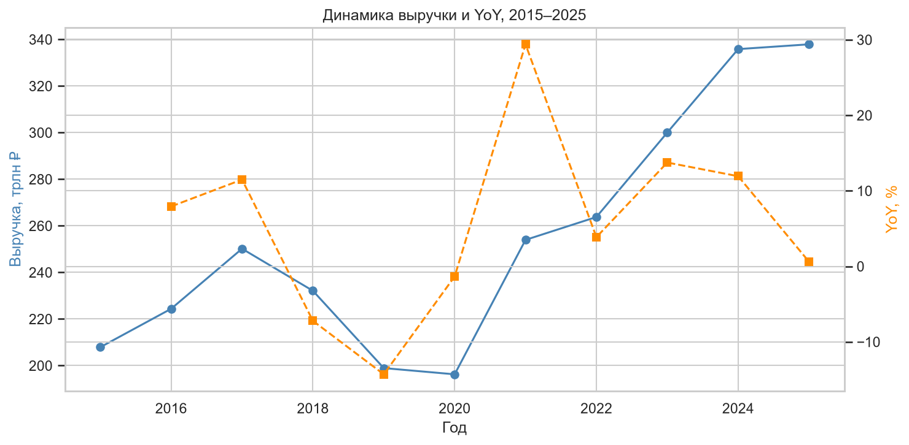
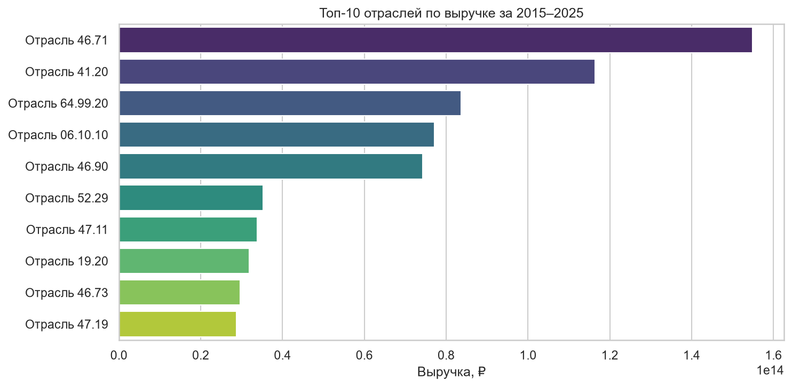
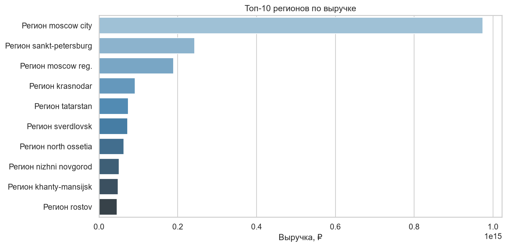
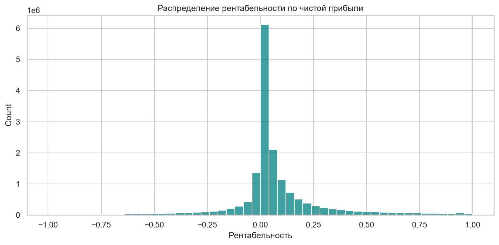

# BI-дашборд: финансовое здоровье российских компаний (RFSD)


## 📋 О проекте

Интерактивный дашборд в **Yandex DataLens** для мониторинга финансовых показателей российских компаний по данным **Russian Financial Statements Database (RFSD)** — открытой гармонизированной базы годовой неконсолидированной отчётности всех действующих российских фирм за 2011–2025 годы.

**Цель:** Подготовка данных, моделирование «звезды», вычисляемые поля, построение управленческого дашборда.

**Данные:** RFSD, версия 3.1.0, Hugging Face `irlspbru/RFSD`. В проекте используются **2015–2025 годы**, чтобы сохранить актуальность и не перегружать модель.

## 🎯 Бизнес-вопросы

1. Какова общая выручка и прибыль компаний по годам?
2. Как меняется выручка год к году (YoY) в целом и по отраслям?
3. Какие отрасли и регионы генерируют наибольшую выручку?
4. Какие компании лидируют по выручке?
5. Как распределяется рентабельность по отраслям?

## 📊 Ключевые инсайты

- **Общая динамика (2015–2025).** Выручка выборки выросла с ~208 трлн ₽ до ~338 трлн ₽ (CAGR ≈ 5%). Кризисные точки — 2018–2020 годы (−7.2%, −14.3% и −1.3% YoY соответственно), восстановление — 2021 (+29.4% YoY). В 2025 году динамика замедлилась до +0.6% — рынок вошёл в фазу стагнации.

- **Рентабельность.** Медиана по чистой прибыли — **2.46%**, 25-й перцентиль — 0.17%, 75-й перцентиль — 10.42%. Типичная картина для российского бизнеса: половина компаний работает с маржой ниже 3%, но верхняя четверть показывает двузначную рентабельность.

- **Концентрация выручки.** Топ-10 компаний по выручке в 2025 году сгенерировали ~23.6 трлн ₽ — около **7%** суммарной выручки выборки. Это 10 из 1.46 млн компаний (0.0007%): концентрация заметная, но не «олигопольная» — эффект широкого покрытия RFSD, включающего малый бизнес.

- **Число компаний в выборке.** 1.61 млн (2015) → 1.46 млн (2025), сокращение ~9%. Часть объясняется ликвидацией, часть — задержками сдачи отчётности за свежие периоды.

- **Отрасли и регионы.** Структура по отраслям и регионам — на графиках `02_top_industries` и `03_top_regions`. RFSD анонимизирован: отрасли и регионы заданы кодами ОКВЭД / ОКТМО без расшифровки, но общая структура соответствует экономической географии РФ. Уточнённые названия и доли — в финальной сборке дашборда.

## 📈 EDA-графики






## 🖼️ Скриншоты дашборда

(появятся позже)

## 🧰 Стек

| Слой | Инструменты |
|---|---|
| **Данные** | Python (Pandas, PyArrow), Hugging Face Datasets |
| **BI** | Yandex DataLens (датасеты, вычисляемые поля, чарты, дашборд) |
| **Моделирование** | Схема «звезда»: факт + измерения |

## 📁 Структура проекта
```
rfsd-financial-dashboard/
├── data/
│   ├── raw/                         # сырые parquet (не коммитятся)
│   ├── processed/                   # CSV для DataLens (не коммитятся)
├── notebooks/
│   ├── 01_data_preparation.ipynb    # загрузка, очистка, «звезда»
│   └── 02_data_exploration.ipynb    # EDA перед сборкой дашборда
├── scripts/
│   └── 03_load_to_postgres.py
├── images/
│   ├── eda/                         # графики из ноутбуков
│   └── dashboard/                   # скриншоты дашборда
├── .env.example
├── .gitignore
├── LICENSE
├── README.md
└── requirements.txt
```

## 🛠️ Методология

**1. Подготовка данных** (`notebooks/01_data_preparation.ipynb`).

**2. Разведочный анализ** (`notebooks/02_data_exploration.ipynb`):
- динамика выручки и YoY;
- топ-10 отраслей и регионов;
- распределение рентабельности;
- топ-10 компаний по выручке.

**3. Сборка дашборда в DataLens**.

## 🚀 Как запустить
1. Клонируйте репозиторий.
2. Установите зависимости: `pip install -r requirements.txt`.
3. Скачайте данные: 
4. 

## ⚠️ Ограничения
1. **Неконсолидированная отчётность.** RFSD содержит отчётность отдельных юрлиц; данные по группам компаний (холдингам) нельзя интерпретировать как консолидированные.
2. **Выбросы.** Часть строк помечена авторами RFSD как outlier=True — в подготовке данных мы их исключаем.
3. **Анонимизация.** Реальные названия компаний, отраслей и регионов в RFSD заменены на ИНН, коды ОКВЭД и ОКТМО. Это не мешает анализу, но ограничивает «узнаваемость» в демо.
4. **Сокращение числа компаний в выборке.** 1.61 млн (2015) → 1.46 млн (2025). Часть объясняется ликвидацией, часть — задержками сдачи отчётности за свежие периоды. При интерпретации YoY за 2025 год это стоит учитывать.
5. **Краткосрочный горизонт.** Дашборд покрывает 2015–2025; долгосрочные эффекты (retention, LTV) в этом наборе не моделируются.

## 👤 Автор
Сухих Елизавета, Junior Data Analyst
- GitHub: [@veta-suhih](https://github.com/veta-suhih)
- LinkedIn: [@vetasuhih](https://www.linkedin.com/in/vetasuhih)
- Telegram: [@veta_suhih](https://t.me/veta_suhih)
- Email: [veta.suhih@gmail.com](mailto:veta.suhih@gmail.com)

## 📄 Лицензия
MIT — используйте код свободно в учебных и коммерческих целях.
Данные RFSD распространяются под CC BY 4.0; при использовании указывайте источник: RFSD, Институт проблем правоприменения Европейского университета в Санкт-Петербурге.